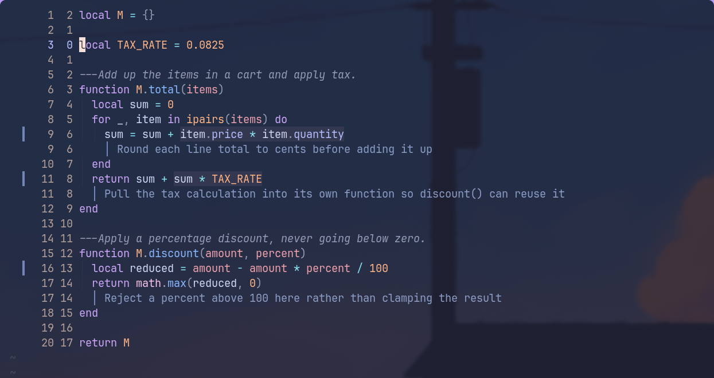
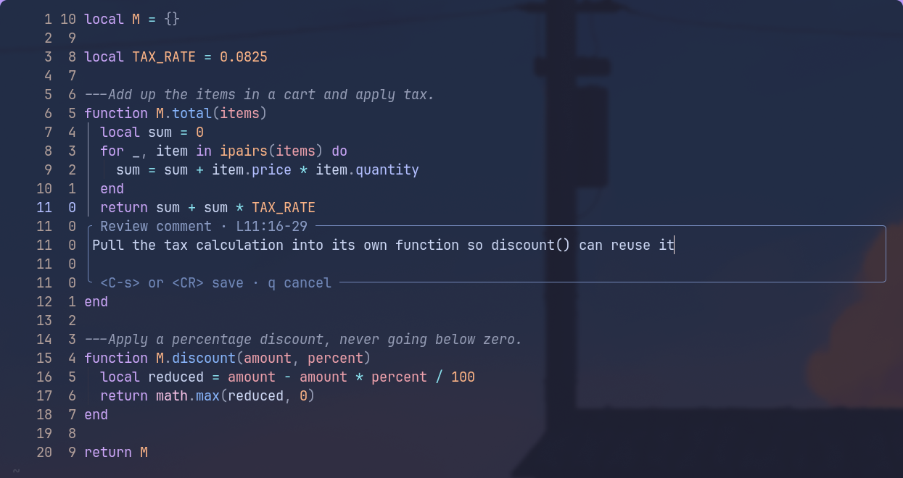

# 💬 `monku.nvim`

> [!WARNING]
> This is AI vibecoded software written for my own personal use. It is not built for sharing openly: expect
> bugs and breaking changes, and no support.

Leave review comments on code as you read it, then send them all to a coding agent.

- comments are anchored to lines, or to an exact span of text, and follow your edits
- shown inline under the code, on hover or all at once
- sent to an agent in your [Herdr](https://herdr.dev) workspace, or copied to the clipboard



## ⚡️ Requirements

- **Neovim** >= 0.11
- [herdr](https://herdr.dev) for `submit` _(optional)_
- [snacks.nvim](https://github.com/folke/snacks.nvim) for pickers _(optional)_

All menus and confirmations prefer Snacks directly, even when its global `vim.ui.select` override is
disabled. If its selector is unavailable, they fall back to `vim.ui.select` (Neovim's numbered menu by
default). The comment list also has a selection-menu fallback.

## 📦 Installation

Install with [lazy.nvim](https://github.com/folke/lazy.nvim):

```lua
{
  "daleyu/monku.nvim",
  lazy = false,
  ---@type table
  opts = {
    -- your configuration comes here
    -- or leave it empty to use the default settings
  },
  keys = {
    { "<leader>ma", function() require("monku").add() end, mode = { "n", "x" }, desc = "Add comment" },
    { "<leader>mg", "<cmd>Monku general<cr>", desc = "Add general comment" },
    { "<leader>mm", "<cmd>Monku<cr>", mode = { "n", "x" }, desc = "Pick an action" },
    { "<leader>ml", "<cmd>Monku list<cr>", desc = "List comments" },
    { "<leader>ms", "<cmd>Monku submit<cr>", desc = "Send to agent" },
    { "]r", "<cmd>Monku next<cr>", desc = "Next comment" },
    { "[r", "<cmd>Monku prev<cr>", desc = "Previous comment" },
  },
}
```

## ⚙️ Configuration

```lua
{
  herdr_bin = vim.env.HERDR_BIN_PATH or "herdr",
  auto_expand = true, -- show a comment inline while the cursor is on its line
  clear_on_submit = true, -- drop the comments once the agent has started on them
  sign = "▍",
  -- sign, border and text are foreground colors; span is the background behind a commented span
  colors = { sign = "#7287b8", border = "#7287b8", text = "#8c9bc4", span = "#333850" },
  max_snippet_lines = 30,
}
```

## 🚀 Usage

`:Monku` opens a picker with every action. Each one is also a subcommand:

| Command | Description |
| --- | --- |
| `:Monku add` | Comment on the current line or visual selection (see below) |
| `:Monku general` | Add a comment not tied to a line |
| `:Monku edit` / `delete` | Edit or delete the comment under the cursor |
| `:Monku next` / `prev` | Jump between comments in the file |
| `:Monku list` | List all comments; `<CR>` jumps, `<C-x>` deletes |
| `:Monku toggle` | Show or hide all comments inline |
| `:Monku copy` | Copy all comments to the clipboard |
| `:Monku submit` | Send all comments to the agent |
| `:Monku clear` | Delete all comments |
| `:Monku delmarks` | Delete all Vim marks |

### Submitting

`submit` sends the review to the agent in the current Herdr workspace (or asks which one, if there are several)
without blocking the editor. Herdr reporting the prompt as sent is not enough: the agent can leave it in its
input box. So Monku confirms delivery before clearing anything:

- An idle agent must start working or ask a question within 6 seconds. If it stalls, Monku presses Enter once
  more and waits another 3 seconds.
- A working agent queues the prompt, but Herdr also reports Claude Code as working while it waits for
  background agents at an idle prompt. So for Claude, Monku reads the bottom of the pane
  (`herdr pane read --source detection`) after a short pause and checks that the review has left Claude's
  input box (shown there as `[Pasted text #N +K lines]` or as its first line). If it is still there, Monku
  presses Enter once more and checks again. Other agents that are working are trusted to queue it.

Only then are the submitted comments cleared (with `clear_on_submit`); comments added or edited meanwhile are
kept. If delivery cannot be confirmed (the agent never starts, the review stays in the input box, or the screen
cannot be read), an error is shown and every comment is kept.

Every submission is also saved to `stdpath("state")/monku/submitted/<UTC time>.md`, and the latest to
`last-submitted.md` beside it.

### Writing a comment

The comment editor is a small buffer under the code. Its text is the comment, and Vim's own commands work on it:

| Key | Action |
| --- | --- |
| `<CR>` (normal mode), `<C-s>`, `:w`, `:wq`, `:x` | Save the comment and close the editor |
| `q`, `<Esc>` (normal mode), `:q`, `:close`, `<C-w>c` | Close; if text would be lost, ask first |
| `:q!`, `:close!` | Close and discard without asking |

Text "would be lost" when a new comment is not blank, or an edited comment differs from the original; otherwise
the editor just closes. The question, "Save this comment?", offers **Save**, **Discard** and **Keep editing**.
Save is first, so accepting the Snacks picker straight away saves; in Neovim's numbered menu choose `1`.
Dismissing the selection keeps editing. The force-close commands above discard without asking.

Moving to another window leaves the editor open with its text, so nothing is asked. A close that is not typed
or pressed in the editor itself (`:qa`, `:tabclose`, a mapping or plugin running `:close`) is refused by Vim
with "No write since last change" while there is unsaved comment text.
`:qa!` also discards unsaved editor text, and closing or killing Neovim does not save a draft automatically.

### Commenting on a selection

What a comment is anchored to depends on how you select:

| Selection | Anchor |
| --- | --- |
| none (normal mode) | the current line |
| `V` (linewise) | the selected lines |
| `v` (characterwise) | exactly the selected text: part of a line, or a span that starts and ends mid-line |
| `<C-v>` (blockwise) | the lines the block touches (same as `V`) |

This holds whether you add through a mapping that calls `require("monku").add()`, `:'<,'>Monku add`, or the
`:Monku` menu. An explicit range such as `:3,5Monku add` comments on whole lines, unless it is exactly the lines
of your last `v` selection, which is how `:'<,'>` arrives.

Adding a comment after selecting `sum * TAX_RATE` with `v`; the title shows the line and column range:



A span is highlighted in the buffer with `MonkuSpan` (`colors.span`) and tracks edits like a line comment. When
the cursor is inside a span, hover, `edit` and `delete` act on that comment, so several spans can share a line.

`copy` and `submit` quote only the selected text and give its position as `file:line:col-col` (or
`file:line:col-line:col` across lines), in 1-based character columns with the end inclusive:

````markdown
## 1. lua/cart.lua:9:17-42
```lua
item.price * item.quantity
```
Round each line total to cents before adding it up

## 2. lua/cart.lua:11:16-29
```lua
sum * TAX_RATE
```
Pull the tax calculation into its own function so discount() can reuse it

## 3. lua/cart.lua:16-17
```lua
  local reduced = amount - amount * percent / 100
  return math.max(reduced, 0)
```
Reject a percent above 100 here rather than clamping the result
````

The first two are spans and the third is a line comment; this is the output for the comments in the
screenshot at the top.

## Tests

Run `python3 tests/run.py` for the isolated editor, selector and submit regression suites (submit runs against
the stand-in `tests/fake-herdr`, never a real agent), or add `--tui` to run
them in a terminal UI. Add `--snacks /path/to/snacks.nvim` to also test the real Snacks picker. Tests use
temporary projects and storage and do not change your comments or clipboard.
